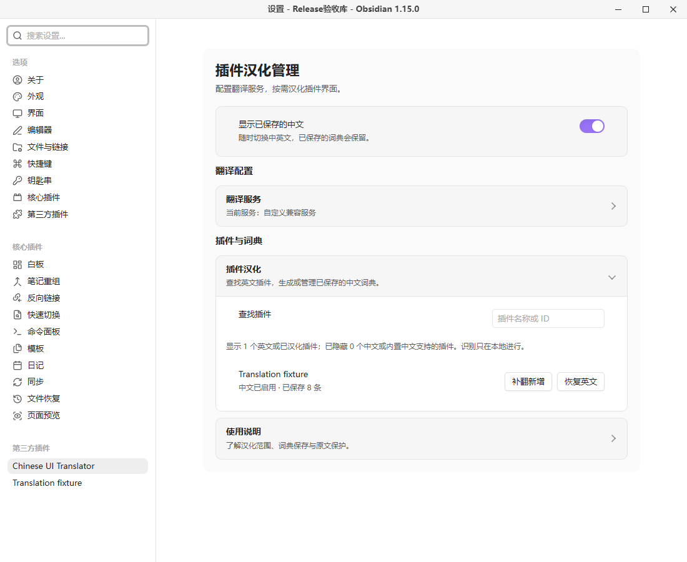
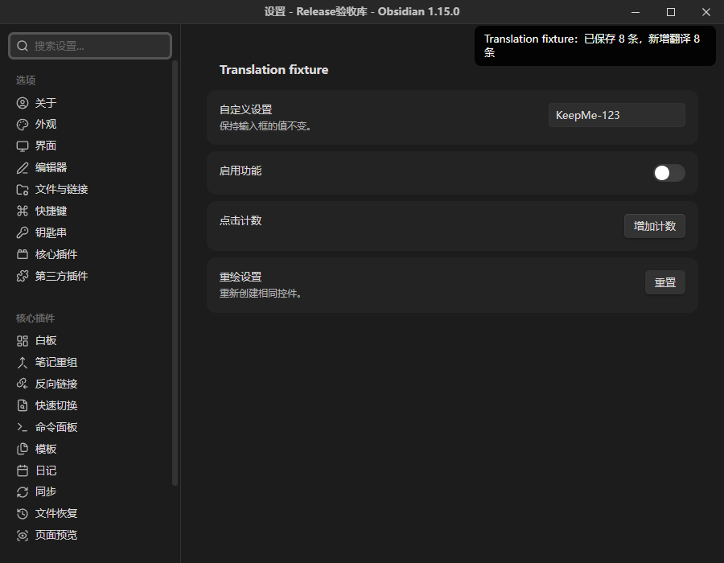
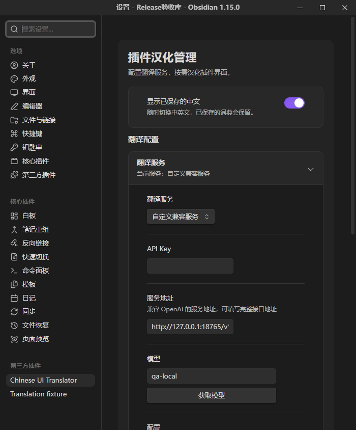

# Chinese UI Translator

Translate recognizable English plugin interface labels into Simplified Chinese and reuse saved dictionaries offline. Plugin names, input values, notes and plugin source files are preserved.

**Author:** Tangerine.Cat · **License:** MIT · **Version:** 0.3.4 · **Requires:** desktop Obsidian 1.15.0 or later.

## Getting started

1. Open Chinese UI Translator in Settings and expand the translation service section.
2. Choose DeepSeek, OpenAI, OpenRouter, a compatible endpoint, DeepL or self-hosted DeepLX. Enter the required key, endpoint and model, then save and test. AI providers support model discovery; machine translation does not need a model.
3. Select an English plugin and translate its labels. Saved dictionaries are applied locally when recognizable settings, menus and plugin controls appear.
4. Restore English without deleting the dictionary, or translate new labels after a plugin update. No new labels means no translation request.

## Privacy, cost and limitations

The plugin is free and open source, with no membership or paid unlock. Third-party services may require accounts, API keys and payment. Only explicit translation, model listing and connection tests send requests. Translation sends extracted static candidate labels to the selected service, with plugin ID context for AI providers; candidates may include non-interface static text. It does not upload complete source files, notes or other plugins' settings.

Service configuration and keys are stored **in plaintext** in this plugin's data.json and may be synced with its folder. Clear the key and save to remove it. Dictionaries use a vault-path hash and are stored **outside the vault**, under `%APPDATA%/ObsidianBilingualAssistant` on Windows, or the user's `.config/ObsidianBilingualAssistant` directory on other desktop systems. Node filesystem access is required for this existing local storage and one-time legacy migration. Uninstalling does not delete these files.

Tested on Windows with Obsidian 1.15.0 using a local simulated service, including light/dark themes and narrow windows. Other desktop operating systems, host versions and real provider accounts were not tested in this release. Dynamic strings, native menus, images, iframes and some controls may remain untranslated. Options without an explicit value keep their original text. No note translation or mobile support. Canceling prevents local results from being applied but may not stop server execution or billing.

## Installation and upgrade

Download the files from [GitHub Releases](https://github.com/Tangerine-Cat888/chinese-ui-translator/releases). Place main.js, manifest.json and styles.css in your vault configuration directory's `plugins/chinese-ui-translator/` folder, or extract the ZIP there. Enable the plugin in Community plugins. Official directory review and GitHub publication are separate statuses.

For upgrades from the old local `bilingual-assistant` ID, disable the old plugin first. The new plugin copies validated settings once and reuses the existing dictionary location; old files remain unchanged. Existing new-ID settings always take precedence, so clearing a key does not import it again. Do not enable both versions simultaneously.



Screenshots use a separate test vault and simulated content, with no personal notes or credentials. See the Chinese guide below for full behavior details and build instructions. [MIT license](LICENSE) · [Third-party notices](THIRD-PARTY-NOTICES.md) · [Release verification](docs/release-verification.md).

---

# 中文使用说明

按需将插件界面汉化为简体中文，保存词典后离线应用，保留插件名称与原始文件。

作者：Tangerine.Cat · MIT · 版本 0.3.4· 桌面 Obsidian 1.15.0+


## 使用

1. 在设置中打开 **Chinese UI Translator**，展开“翻译服务”。
2. 选择服务，填写相应凭证、地址和模型，点击“保存并测试”。AI 服务可获取模型列表；机器翻译无需模型。
3. 在插件列表找到英文插件，点击“汉化”。完成后显示已保存的词条数量。
4. 日常打开可识别的设置、菜单和插件控件时，直接应用本地词典，不自动请求翻译。
5. “恢复英文”保留词典；“启用中文”重新应用。插件更新后可“补翻新增”，无新增词条时不会请求模型。

列表只显示启发式检测为英文或已有词典的插件。中文界面、内置中文支持及未能确定语言的插件默认隐藏。插件名字始终保留，不提供正文翻译。



## 服务与费用

支持 DeepSeek、OpenAI、OpenRouter、自定义 OpenAI 兼容服务、DeepL 和自建 DeepLX。各服务分别保存配置，点击“保存并测试”后切换才生效；保存成功与测试成功分别反馈。

本插件没有会员、试用、付费解锁或授权码。第三方服务可能需要账号和 API Key，并按自己的规则收费；插件不附赠额度。DeepLX 需要自己的实例，自定义服务可使用本地端点。

本轮使用本地模拟端点验证完整使用流程及失败行为，没有使用用户账号逐一实测各供应商。适配器协议由自动测试覆盖；历史 DeepSeek 实测不替代本轮结果。

## 隐私和文件访问

- 只有主动汉化、获取模型或测试连接才访问所选服务。AI 翻译发送静态候选词条和插件 ID 上下文；DeepL/DeepLX 发送词条。静态候选可能包含非界面文本，不上传整个插件源码、笔记正文或其他插件配置。
- 扫描只读取目标插件 main.js，不执行被扫描代码，不改写插件或笔记文件。显示层只修改可识别 DOM 文本和标签属性，支持恢复。
- 服务配置与密钥明文保存在本插件 `data.json`，可能随插件目录同步。清空密钥后保存即可清除；已有词典仍可使用。安装包不包含任何配置或密钥。
- 词典保存在知识库外 `ObsidianBilingualAssistant/<库路径 SHA256 前20位>/translations.json`，用于跨重启离线复用。Windows 为 `%APPDATA%`；其他桌面系统回退到用户主目录的 `.config`。库路径变化会对应不同词典目录。
- 首次升级可以读取同目录的旧加密 `settings.json` 并迁移。标准 data.json 存在后不再读回旧密钥；旧文件保留，避免清空后自动复活。
- 失败或取消不覆盖已保存词典。取消使本地结果失效，已发出的服务器请求仍可能执行和计费。卸载不自动删除配置及词典。

## 支持范围

可覆盖可识别的静态英文标签；动态拼接、外部语言库、图片文字、系统原生菜单、iframe 和封闭 Shadow DOM 不保证支持。没有显式 value 的下拉选项保留英文，避免改变选项值。无法归属单个插件的菜单只用无歧义匹配。

扫描上限为 20,000,000 个 JavaScript 字符、3000 条候选词条。不同插件与主题的 DOM 结构存在差异，不承诺所有界面都能翻译。未知语言检测结果不等于插件不可用。

本轮真实验收为 Windows / Obsidian 1.15.0，包括独立设置窗口、明暗主题、1100×900 和 700×844 窗口。macOS、Linux、其他主题和其他宿主版本未实机验证；不支持移动端。历史性能采样卡顿未证明完整根因，不宣称覆盖所有性能采样组合。



截图均来自独立测试库、模拟服务与测试插件，不包含个人知识内容，不代表真实模型质量。

## 手动安装

发行文件见 [GitHub Releases](https://github.com/Tangerine-Cat888/chinese-ui-translator/releases)。官方社区目录收录状态以审核后台为准；目录上线前可手动安装。

将发行包中的 `chinese-ui-translator` 文件夹放到自己的库配置目录下的 `plugins/` 内，然后在第三方插件中启用。标准配置目录为 `.obsidian`；自定义配置目录按实际位置安装。目录内只需 `main.js`、`manifest.json`、`styles.css`。更新时替换这三个文件，保留自己的 data.json。

内部 ID 和安装目录现为 `chinese-ui-translator`。从本地旧版升级时，先停用 `bilingual-assistant`，再启用新版；若已经提示重复加载，先关闭新版开关再重新启用。新版首次加载会读取旧插件目录的 data.json，并将已验证的服务配置保存到新目录，旧文件保留。新目录已有配置后不重复迁移，清除密钥后不会从旧配置复活。词典继续复用相同的库外目录。无需删除旧目录，也不要同时启用两个版本。

没有额外字体、图库或运行时下载步骤。

## 开发与复现

本轮使用 Node.js 24.15.0 和锁文件。首次安装：

```sh
npm ci --ignore-scripts
npm run lint
npm run check
npm test
npm run build
npm run package
```

`npm run package` 检查版本、三文件白名单、许可证、打包模块与敏感测试标记，并生成固定时间戳 ZIP 和 SHA256。`node scripts/reproduce.mjs` 在两个新目录安装、检查、构建和比较哈希；所有临时材料保留在 work，不能把整个工作目录公开。

本轮 52 项自动测试通过，测试只发现 tests 下的测试文件。src 中历史 legacy-main/dom 参与 lint、类型和回归测试，但不进入发行包。唯一打包运行时依赖是 Acorn，完整许可证嵌入 main.js；见 [第三方说明](THIRD-PARTY-NOTICES.md)。

当前官方 lint 工具的依赖仍声明 ESLint 9；npm 会提示 ESLint 9 已停止维护。已知漏洞审计为 0，不使用强制升级绕过 peer 约束。源码启用完整类型感知 lint；仅保留有同行理由的宿主 this 别名与旧加密设置延迟加载例外。主窗口引用、时钟和设置定义 API 已按官方规则更新。

## 许可证与发布

[MIT](LICENSE)，Copyright (c) 2026 Tangerine.Cat。第三方组件保留原许可证。

[更新记录](CHANGELOG.md) · [发布清单](RELEASE-CHECKLIST.md) · [市场资料草稿](docs/marketplace.md)
