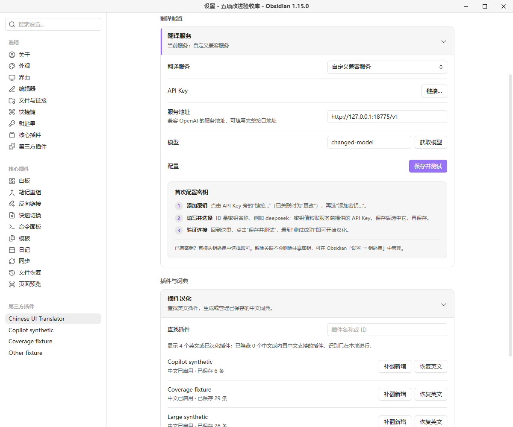
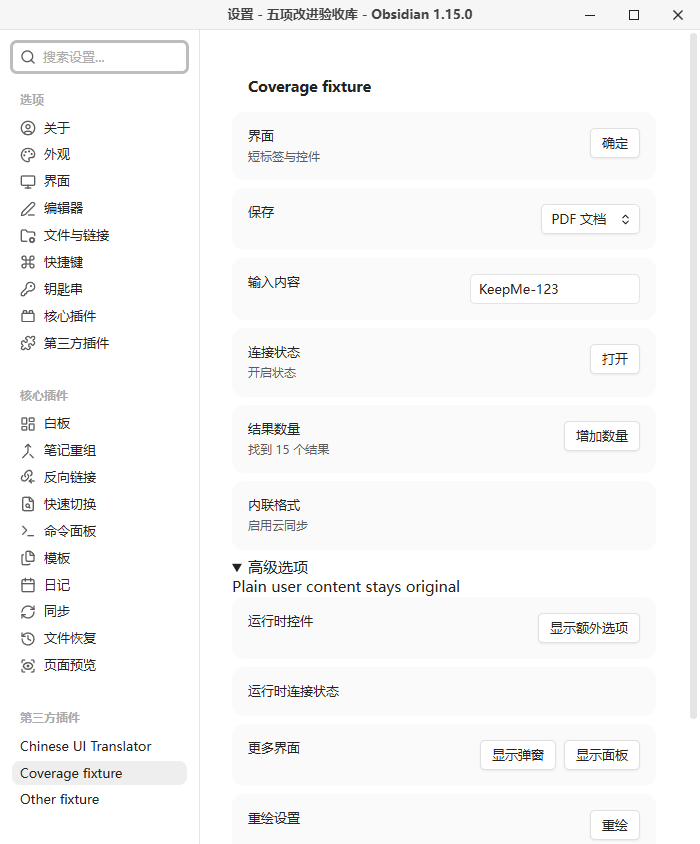

# Chinese UI Translator

Translate recognizable English plugin interface labels into Simplified Chinese and reuse saved dictionaries offline. Plugin names, input values, notes and plugin source files are preserved.

**Author:** Tangerine.Cat · **License:** MIT · **Version:** 0.3.14 · **Requires:** desktop Obsidian 1.15.0 or later.

0.3.5 adds role-aware dictionaries, labels observed while visiting plugin settings, and restricted numeric templates. Visit the target settings page first, then explicitly translate or supplement its labels. Browsing alone sends no requests; unprocessed observations remain only in memory. Numeric templates support at most three simple numeric values in known UI calls, and only apply in a confirmed plugin area. Unknown or conflicting contexts remain unchanged.

Version 0.3.13 includes large-plugin translation with confirmation above 3000 remaining entries, atomic progress checkpoints for resuming interrupted jobs, scoped Copilot settings/chat controls, and generic ARIA-linked labels. Disabling a dictionary also disables local fallback translations. Editable content remains excluded, including empty and plaintext-only contenteditable regions.

Progress files are stored beside the dictionaries outside the vault, contain candidate labels and validated translations, and do not store API keys. Until a task completes, the active dictionary remains unchanged. A changed provider, endpoint or model invalidates old progress; after source changes, only matching candidates are reused. Browsing alone does not send requests. Explicit supplementation may send observed descriptions with dynamic context, even when those descriptions can already be displayed through a local fallback.

## Getting started

1. Open Chinese UI Translator in Settings and expand the translation service section.
2. Choose DeepSeek, OpenAI, OpenRouter, a compatible endpoint, DeepL or self-hosted DeepLX. Create or select an API key through the native keychain control, enter the endpoint and model, then save and test. AI providers support model discovery; machine translation does not need a model.
3. Select an English plugin and translate its labels. Saved dictionaries are applied locally when recognizable settings, menus and plugin controls appear.
4. Restore English without deleting the dictionary, or translate new labels after a plugin update. No new labels means no translation request.

## Privacy, cost and limitations

The plugin is free and open source, with no membership or paid unlock. Third-party services may require accounts, API keys and payment. Only explicit translation, model listing and connection tests send requests. Translation sends extracted static candidate labels and recognized labels observed in visited plugin settings to the selected service, with plugin ID and control-role context for AI providers; candidates may include non-interface static text. It does not upload complete source files, note bodies or input values. Observed descriptions and placeholders may contain dynamically inserted context; the plugin cannot identify and remove all sensitive content. AI services receive role context; DeepL/DeepLX receive the label text only.

Service configuration and secret names are stored in this plugin's data.json; API keys are managed by Obsidian SecretStorage. Select or create a key using the native keychain control. Clearing the association and saving does not delete a shared secret. Existing plaintext keys are migrated only after keychain write/read verification; migration failures preserve the original configuration. Keychain storage is local to Obsidian; this feature does not promise OS-level encryption or key synchronization. Dictionaries use a vault-path hash and are stored **outside the vault**, under `%APPDATA%/ObsidianBilingualAssistant` on Windows, or the user's `.config/ObsidianBilingualAssistant` directory on other desktop systems. Node filesystem access is required for this existing local storage and one-time legacy migration. Uninstalling does not delete these files.

Tested on Windows with Obsidian 1.15.0 using a local simulated service, including light/dark themes and narrow windows. Other desktop operating systems, host versions and real provider accounts were not tested in this release. Dynamic strings, native menus, images, iframes and some controls may remain untranslated. Options without an explicit value keep their original text. No note translation or mobile support. Canceling prevents local results from being applied but may not stop server execution or billing.

## Installation and upgrade

Download the files from [GitHub Releases](https://github.com/Tangerine-Cat888/chinese-ui-translator/releases). Place main.js, manifest.json and styles.css in your vault configuration directory's `plugins/chinese-ui-translator/` folder, or extract the ZIP there. Enable the plugin in Community plugins. Official directory review and GitHub publication are separate statuses.

For upgrades from the old local `bilingual-assistant` ID, disable the old plugin first. The new plugin copies validated settings once and reuses the existing dictionary location; old files remain unchanged. Existing new-ID settings always take precedence, so clearing a key does not import it again. Do not enable both versions simultaneously.



Screenshots use a separate test vault and simulated content, with no personal notes or credentials. See the Chinese guide below for full behavior details and build instructions. [MIT license](LICENSE) · [Third-party notices](THIRD-PARTY-NOTICES.md) · [Release verification](docs/release-verification.md).

---

# 中文使用说明

按需将插件界面汉化为简体中文，保存词典后离线应用，保留插件名称与原始文件。

作者：Tangerine.Cat · MIT · 版本 0.3.13 · 桌面 Obsidian 1.15.0+。


## 使用

1. 在设置中打开 **Chinese UI Translator**，展开“翻译服务”。
2. 选择服务，填写相应凭证、地址和模型，点击“保存并测试”。AI 服务可获取模型列表；机器翻译无需模型。
3. 在插件列表找到英文插件，点击“汉化”。完成后显示已保存的词条数量。
4. 日常打开可识别的设置、菜单和插件控件时，直接应用本地词典，不自动请求翻译。
5. “恢复英文”保留词典；“启用中文”重新应用。插件更新后可“补翻新增”，无新增词条时不会请求模型。

### 0.3.12：通用语义识别

所有插件共用的识别层新增 h5/h6、legend、radio 角色，以及控件通过 aria-labelledby / aria-describedby 显式关联的只读标题和说明。关联文字必须位于同一界面根节点内，ID 唯一且结构简单；继续排除输入、代码、编辑器、笔记内容及包含其他控件的容器。采集与显示使用同一规则，说明文字保留 description 上下文；关联变化后恢复旧文字。

已有词典可直接复用；没有译文的标签仍需主动补翻。本功能不能识别所有无语义的 div/span，也不等于所有插件都已实际验收。Copilot 专项适配继续保留。

### 0.3.11：其他设置页和聊天控件

补齐 Miyo、技能、连接器、命令与自托管设置的标题、状态、说明和表头识别，以及已确认归属 Copilot 聊天视图的空输入提示、当前笔记标签和未配置智能体提示。优先复用词典，少量缺失的固定句式本地补齐；技能标识、命令路径、输入内容与 Markdown 消息区域保持原样。

### 0.3.10：拆分句段与动态说明

Copilot 设置页优先复用词典；对已核实且旧词典缺失的连接词、钥匙串提示句段及活动日志路径说明，提供限定上下文的本地译文回退。动态路径按完整固定句式匹配并原样保留，不放宽为任意动态文本翻译；链接和代码元素保持不变。无需重新请求翻译服务。

### 0.3.9：Copilot 设置页适配

为 Copilot 设置页增加经过核验的自定义标题、标签和说明选择器，复用已有词典，识别规则同时用于本地显示与按需补翻。规则仅作用于确认归属 Copilot 的设置页，不扩大到聊天正文或其他插件；输入值、代码、可编辑区域和 Markdown 内容继续排除。已保存词条数量不等于实际界面覆盖率。

### 0.3.8：大型翻译确认与断点续翻

实际剩余待翻译词条超过 3000 条时，开始请求服务前会提示确认。选择“取消翻译”不会发起翻译请求。每批完成后，将已校验译文与待翻译词条暂存在库外词典目录；中途取消、服务报错或重启后，再点“汉化”或“补翻新增”会接着处理剩余词条。进度显示已完成数量。整轮成功前继续使用原正式词典。

插件源码更新后仅复用仍匹配的候选词条；翻译服务、地址、模型、目标语言或术语配置改变后不复用旧进度。当前批次中尚未收到或未通过校验的译文仍需重试；已发出的服务请求可能计费。进度文件不包含 API Key。

### 0.3.5：补齐漏翻

先打开目标插件设置页，展开有英文的选项，再回到汉化管理点击“补翻新增”（尚未汉化的插件点击“汉化”）。本次运行中访问过的设置页，其可识别标签会暂存在内存，点击汉化时与源码候选合并；仅浏览设置不会请求翻译服务。输入值、笔记区域和文件树不参与采集。尚未开始汉化的暂存标签在重启后不会保留；开始汉化后会随任务进度保存；已保存译文仍可离线使用，补翻不会丢弃此前的运行时词条。

已知界面调用支持提取 OK、save 等短标签及中英混合文字；支持部分被 span/strong 等内联元素拆开的完整标签，以及弹窗标题、说明、折叠标题和明确的交互角色。完整标签译文使用现有文本节点显示，原来的局部加粗位置可能改变；恢复英文时还原原文节点内容。无法确定所属插件的弹窗只应用无歧义的已有译文，不主动采集或联网翻译。尚不支持任意普通 div/span、所有弹窗或原生菜单。

**上下文词典：**访问设置页后，补翻会记录按钮、说明、标题等角色，并将角色传给 AI 翻译服务（DeepL/DeepLX 仅接收文字）。同一个英文词可以按角色保存不同译文。旧词典仍可读取；首次补齐角色时可能需要额外翻译请求。自定义面板仅在其 view.plugin 与宿主已加载插件实例完全一致时确认归属，不按名称前缀或最近点击推测。来源或角色不明确且译文冲突时保留英文。

**受限数字模板：**从已知界面调用中识别 `Found ${count} results` 等模板，仅接受简单变量/属性引用，最多三个数字槽位。翻译时保护占位符，显示时匹配完整固定句式并填回原数字；例如数字从 3 变成 15，不会额外联网。只支持限定长度的非负整数和小数，不支持任意变量文本、千位分隔符、复数语法推断、复杂表达式或字符串相加。只在已确认插件归属的区域应用模板；精确词条优先，冲突时保留原文。占位符缺失或重复会使本次翻译失败并保留原词典。



隐私补充：主动汉化现在还会发送上述已访问设置页的候选标签；界面说明或占位提示可能含插件动态插入的上下文，请勿将此机制理解为能够识别并过滤所有敏感内容。0.3.5 已在 Windows / Obsidian 1.15.0 独立库使用本地模拟服务完成五项改进的真实界面验收，并安装到日常库；未验证真实供应商翻译质量。

列表只显示启发式检测为英文或已有词典的插件。中文界面、内置中文支持及未能确定语言的插件默认隐藏。插件名字始终保留，不提供正文翻译。


## 服务与费用

支持 DeepSeek、OpenAI、OpenRouter、自定义 OpenAI 兼容服务、DeepL 和自建 DeepLX。各服务分别保存配置，点击“保存并测试”后切换才生效；保存成功与测试成功分别反馈。

本插件没有会员、试用、付费解锁或授权码。第三方服务可能需要账号和 API Key，并按自己的规则收费；插件不附赠额度。DeepLX 需要自己的实例，自定义服务可使用本地端点。

本轮使用本地模拟端点验证完整使用流程及失败行为，没有使用用户账号逐一实测各供应商。适配器协议由自动测试覆盖；历史 DeepSeek 实测不替代本轮结果。

## 隐私和文件访问

- 只有主动汉化、获取模型或测试连接才访问所选服务。AI 翻译发送静态候选、已访问设置页的候选标签及插件 ID/控件角色上下文；DeepL/DeepLX 仅发送词条，不使用角色提示。静态候选可能包含非界面文本，不上传整个插件源码、笔记正文或其他插件配置。
- 扫描只读取目标插件 main.js，不执行被扫描代码，不改写插件或笔记文件。显示层只修改可识别 DOM 文本和标签属性，支持恢复。
- 服务配置与密钥名称保存在本插件 `data.json`，密钥由 Obsidian 钥匙串管理。通过原生控件选择或创建密钥；清空关联后保存不会删除共享密钥。钥匙串密钥缺失时会提示重新关联。安装包不包含任何配置或密钥。
- 已有明文密钥会先写入钥匙串并回读验证，再从当前配置中移除；迁移失败保留原配置。旧插件目录、旧加密文件和历史备份保留，不会自动清理。钥匙串是 Obsidian 本地存储，本插件不承诺系统级加密或跨设备密钥同步。
- 词典保存在知识库外 `ObsidianBilingualAssistant/<库路径 SHA256 前20位>/translations.json`，用于跨重启离线复用。Windows 为 `%APPDATA%`；其他桌面系统回退到用户主目录的 `.config`。库路径变化会对应不同词典目录。
- 首次升级可以读取同目录的旧加密 `settings.json` 并迁移。标准 data.json 存在后不再读回旧密钥；旧文件保留，避免清空后自动复活。
- 失败或取消不覆盖已保存词典。取消使本地结果失效，已发出的服务器请求仍可能执行和计费。卸载不自动删除配置及词典。

## 支持范围

可覆盖可识别的静态英文标签；动态拼接、外部语言库、图片文字、系统原生菜单、iframe 和封闭 Shadow DOM 不保证支持。没有显式 value 的下拉选项保留英文，避免改变选项值。无法归属单个插件的菜单只用无歧义匹配。

扫描上限为 20,000,000 个 JavaScript 字符；超过 3000 条的候选词条也可分批翻译，每批最多 12 条。大型插件耗时与服务用量会随词条数量增加，可随时取消；失败或取消不覆盖原词典。不同插件与主题的 DOM 结构存在差异，不承诺所有界面都能翻译。未知语言检测结果不等于插件不可用。

本轮真实验收为 Windows / Obsidian 1.15.0，包括独立设置窗口、明暗主题、1100×900 和 700×844 窗口。macOS、Linux、其他主题和其他宿主版本未实机验证；不支持移动端。历史性能采样卡顿未证明完整根因，不宣称覆盖所有性能采样组合。


旧版截图展示的明文输入框已由 0.3.13 原生钥匙串控件替代，最新界面见文首截图。

截图均来自独立测试库、模拟服务与测试插件，不包含个人知识内容，不代表真实模型质量。

## 手动安装

发行文件见 [GitHub Releases](https://github.com/Tangerine-Cat888/chinese-ui-translator/releases)。官方社区目录收录状态以审核后台为准；目录上线前可手动安装。

将发行包中的 `chinese-ui-translator` 文件夹放到自己的库配置目录下的 `plugins/` 内，然后在第三方插件中启用。标准配置目录为 `.obsidian`；自定义配置目录按实际位置安装。目录内只需 `main.js`、`manifest.json`、`styles.css`。更新时替换这三个文件，保留自己的 data.json。

内部 ID 和安装目录现为 `chinese-ui-translator`。从本地旧版升级时，先停用 `bilingual-assistant`，再启用新版；若已经提示重复加载，先关闭新版开关再重新启用。新版首次加载会读取旧插件目录的 data.json，并将已验证的服务配置保存到新目录，旧文件保留。新目录已有配置后不重复迁移，清除密钥后不会从旧配置复活。词典继续复用相同的库外目录。无需删除旧目录，也不要同时启用两个版本。

没有额外字体、图库或运行时下载步骤。

## 开发与复现

本轮使用 Node.js 24.15.0 和锁文件。首次安装：

```sh
npm ci --ignore-scripts
npm run lint
npm run check
npm test
npm run build
npm run package
```

`npm run package` 检查版本、三文件白名单、许可证、打包模块与敏感测试标记，并生成固定时间戳 ZIP 和 SHA256。`node scripts/reproduce.mjs` 在两个新目录安装、检查、构建和比较哈希；所有临时材料保留在 work，不能把整个工作目录公开。

本轮 90 项自动测试通过，测试只发现 tests 下的测试文件。src 中历史 legacy-main/dom 参与 lint、类型和回归测试，但不进入发行包。唯一打包运行时依赖是 Acorn，完整许可证嵌入 main.js；见 [第三方说明](THIRD-PARTY-NOTICES.md)。

当前官方 lint 工具的依赖仍声明 ESLint 9；npm 会提示 ESLint 9 已停止维护。已知漏洞审计为 0，不使用强制升级绕过 peer 约束。源码启用完整类型感知 lint；仅保留有同行理由的宿主 this 别名与旧加密设置延迟加载例外。主窗口引用、时钟和设置定义 API 已按官方规则更新。

## 许可证与发布

[MIT](LICENSE)，Copyright (c) 2026 Tangerine.Cat。第三方组件保留原许可证。

[更新记录](CHANGELOG.md) · [发布清单](RELEASE-CHECKLIST.md) · [市场资料草稿](docs/marketplace.md)
